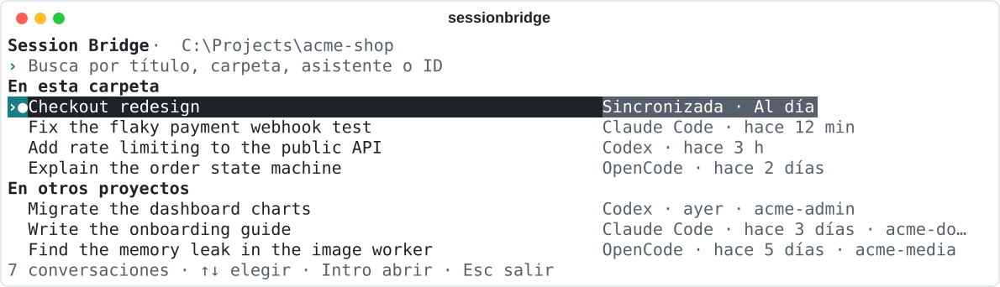
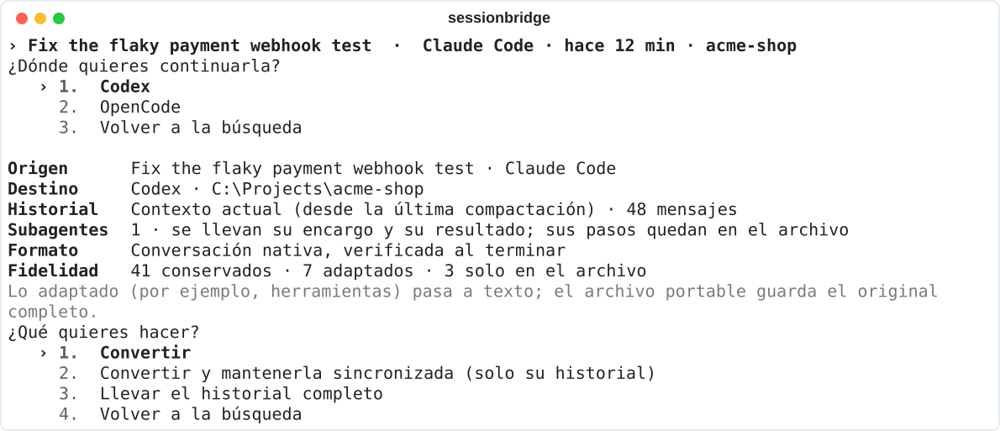
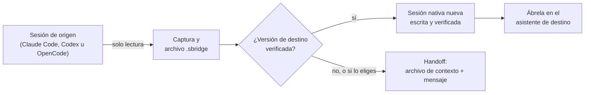
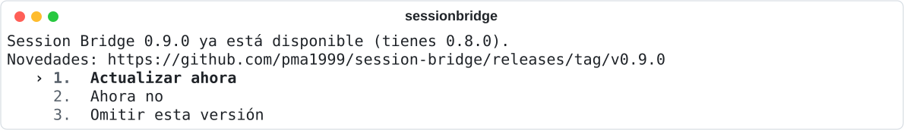

<p align="right"><a href="README.md">English</a> · <strong>Español</strong></p>

# Session Bridge

**Empieza una conversación en Claude Code y continúala en Codex u OpenCode.** Session Bridge encuentra todas las conversaciones de tus asistentes de programación y convierte cualquiera de ellas en una sesión real de otro asistente, lista para reanudar, con un archivo portable de lo que se ha llevado.

[](https://github.com/pma1999/session-bridge/actions/workflows/ci.yml) [](https://github.com/pma1999/session-bridge/releases/latest) [](pyproject.toml) [](#compatibilidad) [](LICENSE)

<picture>
  <source media="(prefers-color-scheme: dark)" srcset="docs/images/home-es-dark.svg">
  
</picture>

## Por qué

Cada asistente de programación guarda sus conversaciones en su propio formato, así que cambiar de herramienta suele obligarte a empezar de cero y volver a explicarlo todo. Session Bridge lee esos formatos directamente, lleva la conversación al otro lado y escribe una sesión nueva que el otro asistente abre como si siempre hubiera estado ahí. Funciona en tu equipo, nunca llama a un modelo y nunca modifica la conversación de la que copia.

## Qué puedes hacer

- **Encontrar cualquier conversación.** Una sola búsqueda sobre todas las sesiones de Claude Code, Codex y OpenCode, con la carpeta actual primero. No distingue mayúsculas, acentos ni orden de las palabras.
- **Continuarla en otro sitio.** Convierte una conversación en una sesión nativa de otro asistente y ábrela allí, lista para tu siguiente mensaje.
- **Mantener dos asistentes al día.** Vincula una conversación y Session Bridge sigue sus turnos nuevos, para que puedas ir y volver entre asistentes. Solo en Windows y desactivado hasta que lo actives.
- **Llevártela contigo.** Exporta una conversación a un archivo portable `.sbridge` e impórtala después, en cualquier equipo.
- **Pasarla a cualquier asistente.** Para versiones que Session Bridge no ha verificado, prepara un archivo de contexto y un mensaje para que lo pegues tú.
- **Con red de seguridad.** Cada transferencia guarda un archivo verificado y se puede recuperar si se interrumpe. Las versiones desconocidas de los asistentes se rechazan; nunca se adivina su formato.

## Instalación

Necesitas Windows, [Python 3.11 o posterior](https://www.python.org/downloads/) y al menos uno de los asistentes compatibles.

1. Descarga `session-bridge-X.Y.Z-portable.zip` de la [última versión](https://github.com/pma1999/session-bridge/releases/latest) y extráelo en una carpeta que vayas a conservar, o clona el repositorio.
2. Desde esa carpeta, ejecuta el instalador:

   ```powershell
   powershell -NoProfile -ExecutionPolicy Bypass -File scripts/install.ps1 -Python python
   ```

3. Comprueba que funciona:

   ```powershell
   sessionbridge doctor
   ```

El instalador crea un entorno de Python propio y deja el comando `sessionbridge` en `%USERPROFILE%\.local\bin`. Si esa carpeta no está en tu `PATH`, te lo dice. Nunca instala ni modifica los asistentes. A partir de ahí, [Session Bridge se actualiza solo](#actualizaciones).

> [!IMPORTANT]
> Antes de tu primera transferencia, haz una copia de seguridad de los datos de los asistentes que no puedas permitirte perder. Session Bridge solo añade sesiones nuevas y nunca edita las existentes, pero cada asistente es dueño de su almacenamiento y puede cambiarlo en cualquier versión.

## Primeros pasos

Abre una terminal en la carpeta de tu proyecto y ejecuta:

```powershell
sessionbridge
```

1. **Encuentra la conversación.** Escribe unas letras de su título, su carpeta o su asistente. Las conversaciones de la carpeta actual salen primero, en **En esta carpeta**; las demás siguen en **En otros proyectos**. Las conversaciones vinculadas llevan la marca **●**.
2. **Elige dónde continuarla.** Escoge el otro asistente. Session Bridge te muestra qué se va a llevar: cuántos mensajes, si el historial empieza en la última compactación o desde el principio, y qué cambia por el camino.
3. **Convierte.** Session Bridge escribe la sesión nueva, la verifica y te ofrece abrirla en ese momento.

<picture>
  <source media="(prefers-color-scheme: dark)" srcset="docs/images/convert-es-dark.svg">
  
</picture>

Muévete con las flechas o el tabulador, elige con Intro y vuelve atrás con Esc. Todo se puede hacer solo con el teclado. Las capturas usan conversaciones inventadas.

¿Prefieres comandos? Todo lo que hace la pantalla de inicio es también un comando, y `--json` permite usar cualquiera desde scripts:

```powershell
sessionbridge list --search "payment webhook"
sessionbridge convert claude-win:SESSION_ID --to codex-win --dry-run
sessionbridge convert claude-win:SESSION_ID --to codex-win --resume
```

La [guía de usuario](docs/user-guide.md) recorre cada tarea y la [referencia de comandos](docs/cli-reference.md) recoge todas las opciones (ambas en inglés).

## Cómo funciona



Session Bridge lee la conversación de origen sin modificarla, guarda un archivo completo de ella y escribe una sesión **nueva** en el formato propio del asistente de destino. Las instrucciones, aprobaciones y llamadas a herramientas sin terminar del origen viajan como historial, nunca como permisos: se aplica la configuración del asistente de destino. Cada transferencia queda registrada en un diario, de modo que una transferencia interrumpida se completa con `sessionbridge recover` en vez de repetirse.

## Compatibilidad

Session Bridge solo escribe sesiones nativas para las versiones de cada asistente en las que se han comprobado cuatro cosas: la sesión persiste, aparece en el historial del asistente, se reanuda al volver a abrir el asistente y el modelo recibe el contexto importado.

| Plataforma | Asistente | Sesiones nativas |
| --- | --- | --- |
| Windows x64 | Claude Code 2.1.304 | Activadas |
| Windows x64 | OpenCode 2.0.29 | Activadas, hasta 9.362 mensajes |
| Windows x64 | Codex CLI 0.159.0 | Activadas, hasta 128 MiB por archivo de conversación |
| Linux y WSL | Cualquiera | No activadas; el handoff está disponible |

Se han probado las seis direcciones entre los tres asistentes de Windows con Claude Code 2.1.302; las direcciones hacia Claude Code no se han vuelto a probar con la 2.1.304. Cualquier otra versión se rechaza para escritura nativa hasta que se verifique, y el handoff sigue disponible. Las [pruebas de compatibilidad](docs/native-compatibility.md) y el [registro de verificación](docs/verification.md) describen exactamente qué se ha probado.

## Sincronización

Al vincular una conversación, la tienes disponible en todos los asistentes que uses: Session Bridge sigue sus turnos terminados en segundo plano y, cuando cambias de asistente, reabre la sesión de ese asistente si está al día o crea una nueva con los últimos turnos. Si continúas en dos sitios, no se sobrescribe nada; eliges qué continuación seguir.

```powershell
sessionbridge sync link claude-win:SESSION_ID --name "Rediseño del checkout"
sessionbridge sync open "Rediseño del checkout" --to codex-win
sessionbridge sync status "Rediseño del checkout"
```

La sincronización solo funciona en Windows y no hace nada hasta que vinculas una conversación. Sigue conversaciones, no archivos, ni el estado de Git, ni procesos en marcha. Lee la [guía de sincronización](docs/synchronization.md) antes de confiar en ella.

## Actualizaciones

Cuando se publica una versión nueva, Session Bridge te pregunta la próxima vez que lo abres:

<picture>
  <source media="(prefers-color-scheme: dark)" srcset="docs/images/update-es-dark.svg">
  
</picture>

**Actualizar ahora** descarga la versión, la comprueba con sus sumas SHA-256 publicadas, la instala y vuelve a abrir Session Bridge en la versión nueva. **Ahora no** vuelve a preguntar al día siguiente, y **Omitir esta versión** espera a la siguiente. Si algo falla, la versión que tienes sigue funcionando. Una copia de Git se actualiza con Git, y solo si está limpia. Consulta [cómo funcionan las actualizaciones](docs/updates.md) para más detalle, o compruébalo a mano:

```powershell
sessionbridge update --check
```

## Idioma

Session Bridge habla español e inglés y sigue el idioma de tu sistema. Para elegir uno:

```powershell
sessionbridge language es
sessionbridge language auto
```

Solo cambia el texto que lees. Los comandos, la salida JSON, los códigos de error y los archivos son iguales en todos los idiomas.

## Privacidad y seguridad

- **Todo en local.** Session Bridge no tiene servidor. La única petición de red que hace por su cuenta es la comprobación diaria de actualizaciones en GitHub, que puedes desactivar con `sessionbridge update --startup-check off`.
- **Sin llamadas a modelos.** Listar, convertir, exportar y sincronizar nunca ejecutan un modelo. La conversación la continúa el asistente de destino, con su propia configuración y su propia cuenta.
- **El origen solo se lee.** La conversación de origen nunca se modifica. Una transferencia crea una sesión nueva; nunca edita ni sustituye una existente.
- **Nada se adivina.** Las versiones desconocidas, los historiales ambiguos y las conversaciones demasiado grandes se rechazan con una explicación; nunca se recortan ni se aproximan.
- **Tus datos son tuyos.** Las transferencias, los archivos y los datos de sincronización están en `%LOCALAPPDATA%\SessionBridge`. Contienen historial de conversaciones, así que trata como privadas las copias de esa carpeta.

Consulta la [política de seguridad](SECURITY.md) para informar de una vulnerabilidad.

## Solución de problemas

| Ves | Qué hacer |
| --- | --- |
| *Versión nativa no verificada; selecciona explícitamente el modo handoff.* o *La conversión nativa no está verificada para este destino.* | La versión de tu asistente no está en la [tabla de compatibilidad](#compatibilidad). Elige el handoff que ofrece la pantalla de inicio, o usa `--mode handoff`. |
| *La sesión de origen está activa; solicita una instantánea.* | La conversación sigue abierta en su asistente. Termina el turno, o deja que Session Bridge copie su estado actual. |
| No se reconoce `sessionbridge` | Añade `%USERPROFILE%\.local\bin` al `PATH` de tu usuario y abre una terminal nueva. |
| El instalador dice *Refusing to replace an unmanaged command.* | Hay un `sessionbridge.exe` que no creó el instalador. Comprueba que es tuyo, bórralo y vuelve a ejecutar el instalador. |
| *No se pudo instalar la actualización* | El mensaje indica dónde está el registro del instalador. La versión que tienes sigue funcionando; ejecuta `sessionbridge update` para reintentarlo. |

La [guía de usuario](docs/user-guide.md#troubleshooting) cubre más casos, y `sessionbridge doctor` muestra qué asistentes puede leer y escribir Session Bridge.

## Documentación

La documentación detallada está en inglés.

| Para | Lee |
| --- | --- |
| Usar Session Bridge | [Guía de usuario](docs/user-guide.md) · [Referencia de comandos](docs/cli-reference.md) · [Sincronización](docs/synchronization.md) · [Actualizaciones](docs/updates.md) |
| Qué se ha verificado | [Compatibilidad nativa](docs/native-compatibility.md) · [Registro de verificación](docs/verification.md) · [Cambios](CHANGELOG.md) |
| Contribuir | [Guía de contribución](CONTRIBUTING.md) · [Arquitectura](docs/architecture.md) · [Contrato de implementación](docs/CONTRACT.md) · [Mantenimiento](docs/maintaining.md) |

## Contribuir

Las incidencias y las pull requests son bienvenidas. Empieza por la [guía de contribución](CONTRIBUTING.md): explica cómo preparar el proyecto, cómo está organizado el código y qué necesita un cambio para integrarse. Sigue el [código de conducta](CODE_OF_CONDUCT.md).

## Licencia

[MIT](LICENSE). Session Bridge es un proyecto comunitario independiente. No está afiliado a Anthropic, OpenAI, OpenCode ni a sus responsables, ni cuenta con su respaldo o soporte. Claude Code, Codex y OpenCode son nombres de sus respectivos propietarios.
