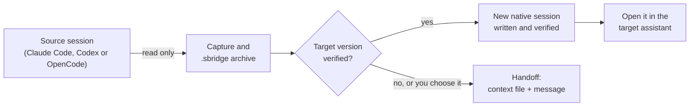
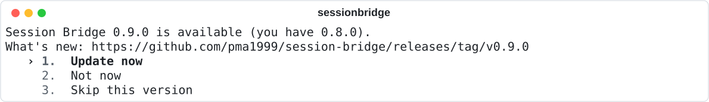

<p align="right"><strong>English</strong> · <a href="README.es.md">Español</a></p>

# Session Bridge

**Start a conversation in Claude Code, continue it in Codex or OpenCode.** Session Bridge finds every coding-agent conversation on your machine and turns any of them into a real, resumable session in another assistant, with a portable archive of what was moved.

[](https://github.com/pma1999/session-bridge/actions/workflows/ci.yml) [](https://github.com/pma1999/session-bridge/releases/latest) [](pyproject.toml) [](#compatibility) [](LICENSE)

<picture>
  <source media="(prefers-color-scheme: dark)" srcset="docs/images/home-en-dark.svg">
  
</picture>

## Why

Each coding assistant keeps its conversations in its own format, so switching tools usually means starting over and explaining everything again. Session Bridge reads those formats directly, carries the conversation across, and writes a new session the other assistant opens as if it had been there all along. It runs locally, never calls a model, and never changes the conversation it copies from.

## What you can do

- **Find any conversation.** One search over every Claude Code, Codex and OpenCode session, with the current folder first. It ignores case, accents and word order.
- **Continue it elsewhere.** Convert a conversation into a native session of another assistant and open it there, ready for your next message.
- **Keep two assistants in step.** Link a conversation, and Session Bridge follows its new turns, so you can switch back and forth. Windows only, and off until you turn it on.
- **Take it with you.** Export a conversation to a portable `.sbridge` archive and import it later, on any machine.
- **Hand off to anything.** For versions Session Bridge has not verified, it prepares a context file and a message for you to paste yourself.
- **Stay safe.** Every transfer keeps a verified archive and can be recovered if it is interrupted. Unknown client versions are refused, never guessed at.

## Install

You need Windows, [Python 3.11 or newer](https://www.python.org/downloads/) and at least one of the supported assistants.

1. Download `session-bridge-X.Y.Z-portable.zip` from the [latest release](https://github.com/pma1999/session-bridge/releases/latest) and extract it to a folder you will keep, or clone the repository.
2. From that folder, run the installer:

   ```powershell
   powershell -NoProfile -ExecutionPolicy Bypass -File scripts/install.ps1 -Python python
   ```

3. Check it works:

   ```powershell
   sessionbridge doctor
   ```

The installer creates a private Python environment and puts the `sessionbridge` command in `%USERPROFILE%\.local\bin`. If that folder is not on your `PATH`, the installer says so. It never installs or changes the coding assistants themselves. From then on, [Session Bridge updates itself](#updates).

> [!IMPORTANT]
> Before your first transfer, back up any assistant data you cannot afford to lose. Session Bridge only adds new sessions and never edits existing ones, but the assistants own their storage and can change it at any release.

## Getting started

Open a terminal in your project folder and run:

```powershell
sessionbridge
```

1. **Find the conversation.** Type a few letters of its title, folder or assistant. Conversations from the current folder come first, under **In this folder**; everything else follows under **In other projects**. Linked conversations are marked **●**.
2. **Choose where to continue it.** Pick the other assistant. Session Bridge shows what will be taken: how many messages, whether the history goes back to the last compaction or the very beginning, and what changes on the way.
3. **Convert.** Session Bridge writes the new session, verifies it, and offers to open it right away.

<picture>
  <source media="(prefers-color-scheme: dark)" srcset="docs/images/convert-en-dark.svg">
  
</picture>

Use the arrow keys or Tab to move, Enter to choose and Esc to go back. Every screen works with the keyboard alone. The pictures above use made-up conversations.

Prefer commands? Everything the start screen does is also a command, and `--json` makes every command scriptable:

```powershell
sessionbridge list --search "payment webhook"
sessionbridge convert claude-win:SESSION_ID --to codex-win --dry-run
sessionbridge convert claude-win:SESSION_ID --to codex-win --resume
```

The [user guide](docs/user-guide.md) walks through every task, and the [command reference](docs/cli-reference.md) lists every option.

## How it works



Session Bridge reads the source conversation without changing it, stores a complete archive of it, and then writes a **new** session in the target assistant's own format. Instructions, approvals and unfinished tool calls from the source are carried as history, never as permissions: the target assistant's own settings apply. A transfer is recorded in a journal, so an interrupted one can be finished with `sessionbridge recover` instead of being repeated.

## Compatibility

Session Bridge writes native sessions only for client versions where four things were observed: the session persists, it shows in the assistant's history, it resumes from a cold start, and the model receives the imported context.

| Platform | Assistant | Native sessions |
| --- | --- | --- |
| Windows x64 | Claude Code 2.1.304 | Enabled |
| Windows x64 | OpenCode 2.0.29 | Enabled, up to 9,362 messages |
| Windows x64 | Codex CLI 0.159.0 | Enabled, up to 128 MiB per conversation file |
| Linux and WSL | Any | Not enabled; handoff is available |

All six directions between the three Windows assistants were exercised with Claude Code 2.1.302; the directions into Claude Code were not run again on 2.1.304. Any other version is refused for native writing until it has been verified, and handoff remains available. The [compatibility evidence](docs/native-compatibility.md) and the [verification record](docs/verification.md) describe exactly what was tested.

## Synchronization

Linking a conversation keeps it available in every assistant you use: Session Bridge follows its finished turns in the background, and when you switch assistant it reopens that assistant's session if it is up to date, or creates a new one with the latest turns. If you continue in two places, nothing is overwritten; you choose which continuation to follow.

```powershell
sessionbridge sync link claude-win:SESSION_ID --name "Checkout redesign"
sessionbridge sync open "Checkout redesign" --to codex-win
sessionbridge sync status "Checkout redesign"
```

Synchronization runs on Windows only and does nothing until you link a conversation. It follows conversations, not files, Git state or running processes. Read the [synchronization guide](docs/synchronization.md) before you rely on it.

## Updates

When a new release is published, Session Bridge asks the next time you open it:

<picture>
  <source media="(prefers-color-scheme: dark)" srcset="docs/images/update-en-dark.svg">
  
</picture>

**Update now** downloads the release, checks it against its published SHA-256 checksums, installs it and reopens Session Bridge on the new version. **Not now** asks again the next day, and **Skip this version** waits for the next one. If anything fails, the version you have keeps working. A Git clone updates with Git instead, and only when it is clean. Read [how updates work](docs/updates.md) for the details, or check by hand:

```powershell
sessionbridge update --check
```

## Language

Session Bridge speaks English and Spanish and follows your system language. To choose one:

```powershell
sessionbridge language es
sessionbridge language auto
```

Only the text you read changes. Commands, JSON output, error codes and archives are the same in every language.

## Privacy and safety

- **Local only.** Session Bridge has no server. The only network request it makes on its own is the daily update check to GitHub, which you can turn off with `sessionbridge update --startup-check off`.
- **No model calls.** Listing, converting, exporting and synchronizing never run a model. Continuing the conversation is done by the target assistant, under its own settings and account.
- **Read only on the source.** The source conversation is never modified. A transfer creates a new session; it never edits or replaces an existing one.
- **Nothing guessed.** Unknown client versions, ambiguous histories and oversized conversations are refused with an explanation, never truncated or approximated.
- **Your data stays yours.** Transfers, archives and synchronization data live in `%LOCALAPPDATA%\SessionBridge`. They contain conversation history, so treat backups of that folder as private.

See the [security policy](SECURITY.md) to report a vulnerability.

## Troubleshooting

| You see | What to do |
| --- | --- |
| *This native version is not verified; choose handoff mode explicitly.* or *Native conversion is not verified for this target.* | Your assistant's version is not in the [compatibility table](#compatibility). Choose the handoff the start screen offers, or pass `--mode handoff`. |
| *The source session is active; request a snapshot.* | The conversation is still open in its assistant. Finish the turn, or let Session Bridge take a snapshot of what is there now. |
| `sessionbridge` is not recognized | Add `%USERPROFILE%\.local\bin` to your user `PATH` and open a new terminal. |
| The installer says *Refusing to replace an unmanaged command.* | A `sessionbridge.exe` the installer did not create is in the way. Check that it is yours, delete it, and run the installer again. |
| *The update could not be installed* | The message names the installer's log. The version you have keeps working; run `sessionbridge update` to try again. |

The [user guide](docs/user-guide.md#troubleshooting) covers more cases, and `sessionbridge doctor` shows which assistants Session Bridge can read and write.

## Documentation

| For | Read |
| --- | --- |
| Using Session Bridge | [User guide](docs/user-guide.md) · [Command reference](docs/cli-reference.md) · [Synchronization](docs/synchronization.md) · [Updates](docs/updates.md) |
| What was verified | [Native compatibility](docs/native-compatibility.md) · [Verification record](docs/verification.md) · [Changelog](CHANGELOG.md) |
| Contributing | [Contributing guide](CONTRIBUTING.md) · [Architecture](docs/architecture.md) · [Implementation contract](docs/CONTRACT.md) · [Maintaining](docs/maintaining.md) |

## Contributing

Issues and pull requests are welcome. Start with the [contributing guide](CONTRIBUTING.md): it explains how to set up the project, how the code is organized and what a change needs before it is merged. Please follow the [code of conduct](CODE_OF_CONDUCT.md).

## License

[MIT](LICENSE). Session Bridge is an independent community project. It is not affiliated with, endorsed by or supported by Anthropic, OpenAI, OpenCode or their maintainers. Claude Code, Codex and OpenCode are names of their respective owners.
