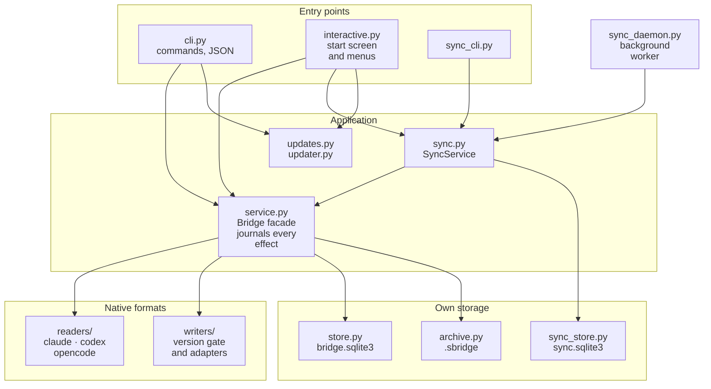
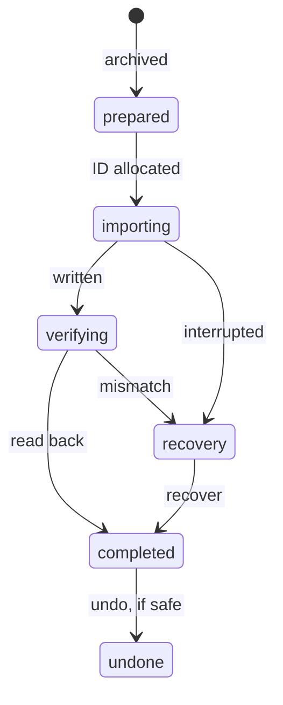

# Architecture

This page explains how Session Bridge is put together and which rules each part keeps. It is written for contributors: read it before changing a reader, a writer, the journal, synchronization or the updater. The exact interfaces are in the [implementation contract](CONTRACT.md).

**Contents**

- [The big picture](#the-big-picture)
- [Modules](#modules)
- [A transfer, step by step](#a-transfer-step-by-step)
- [The `.sbridge` archive](#the-sbridge-archive)
- [What is stored where](#what-is-stored-where)
- [Safety rules](#safety-rules)
- [Synchronization](#synchronization)
- [Updates](#updates)
- [WSL](#wsl)
- [Texts and languages](#texts-and-languages)
- [Where to start a change](#where-to-start-a-change)

## The big picture

Three ideas shape the whole design:

1. **Read natively, write natively, verify everything.** Each assistant's format is read by its own reader and written by its own writer. A native write is enabled for client versions that passed four runtime checks and for newer ones with the same major number whose format still checks out, and every write is read back before it counts.
2. **The archive and the context are separate.** What was captured is preserved completely in an archive; what is sent to the target (the *projection*) is a chosen part of it. Choosing less context never loses data.
3. **Effects go through one journal.** Every write to an assistant's storage is recorded before it happens, so an interruption is recovered, never repeated.

The CLI and the start screen use the same facade, `service.Bridge`, so everything the start screen does is also available as a command, with or without a terminal.

## Modules

All code is in `src/session_bridge/`.

| Area | Modules | Responsibility |
| --- | --- | --- |
| Entry points | `cli.py`, `sync_cli.py`, `interactive.py`, `ui.py`, `update_flow.py` | Commands, the JSON envelope, the start screen and menus, shared wording, the update offer. |
| Application | `service.py`, `projection.py`, `history.py`, `catalog.py` | The `Bridge` facade; choosing the context to send; edited-message versions; metadata search and folder matching. |
| Contracts | `models.py`, `errors.py` | Versioned interchange models (Pydantic) and content-free public errors. |
| Native formats | `readers/`, `writers/`, `profiles.py` | Reading each assistant's storage, the version gate and native writers, discovering installations. |
| Own storage | `store.py`, `archive.py`, `locks.py`, `jsonfile.py`, `settings.py` | The transfer journal, the `.sbridge` format, OS file locks, small JSON documents, preferences. |
| Synchronization | `sync.py`, `sync_capture.py`, `sync_store.py`, `sync_daemon.py` | Linked conversations, checkpoint capture, the revision store, the background worker. |
| Updates | `releases.py`, `installation.py`, `updates.py`, `updater.py`, `net.py` | Reading GitHub releases, detecting the installation, the check policy, installing, hardened downloads. |
| WSL | `wsl.py`, `helper.py`, `bootstrap.py` | The Windows side of WSL calls, the helper that answers inside the distribution, its installation. |
| Texts | `i18n/` | The English and Spanish catalogs, language choice, translated `--help`. |

## A transfer, step by step

1. **Read.** The reader captures the source session read-only. SQLite sources are opened in `mode=ro` with `query_only`, and only the assistant's own session tables are queried; native databases are never copied or restored. Files that change while being read are detected.
2. **Project.** `projection.py` selects the context: the current context since the last compaction, the full lineage, or from a chosen message. Unknown relationships are never guessed: the conversation is marked ambiguous and the user chooses.
3. **Archive.** The full capture is stored as a `.sbridge` archive whose SHA-256 is bound to the transfer in the journal.
4. **Gate.** `writers/registry.py` checks the target's version: a verified one, or a newer one with the same major number whose format is checked (Claude Code before writing, Codex and OpenCode by the readback). Anything else refuses native writing; handoff only happens when the caller asks for it.
5. **Write.** The native ID is allocated first, then the adapter writes. Publication is exclusive: an existing session is never replaced.
6. **Verify.** The adapter reads the session back through the assistant's own format and compares it with what was sent. An exit code alone never completes a transfer.

Errors move a transfer to *recovery*. `recover` inspects what exists for that exact native ID and completes or diagnoses it; it never blindly repeats an import.

## The `.sbridge` archive

A `.sbridge` file is a ZIP with `manifest.json`, `conversation.json` and content-addressed `attachments/<sha256>` members. Before anything is extracted, Session Bridge checks:

- the format version and the exact set of members;
- every member's hash, size and compression ratio, and the member count;
- that attachment references match the members.

Duplicate members or JSON keys, links, absolute, drive, backslash or `..` paths and encrypted entries are refused. Foreign file names and paths are never used for extraction. Limits produce an error, never a truncated result. Archives have no executable hooks. SHA-256 detects corruption; it does not authenticate who made an archive.

## What is stored where

| File | Owner | Holds |
| --- | --- | --- |
| `bridge.sqlite3` | `store.py` | The transfer journal (schema 1), registered profiles. Operational metadata only, no conversation bodies. |
| `transfers/<id>/` | `service.py` | Each transfer's archive and handoff files. |
| `sync.sqlite3` | `sync_store.py` | Linked conversations, immutable revisions, compressed content-addressed captures (schema 1). |
| `worker.json`, `worker*.lock` | `sync_daemon.py` | Worker diagnostics and its lifetime lock. |
| `settings.json` | `settings.py` | Language and the update-check preference. |
| `update.json`, `update.lock`, `logs/` | `updates.py`, `updater.py` | Update state, the install lock and installer logs. |
| `installation.json`, `app/`, `runtime/` | `scripts/install.ps1`, `updater.py` | Which installation is in use; release and runtime folders created by updates. |

The data folder is `%LOCALAPPDATA%\SessionBridge` on Windows, `$XDG_DATA_HOME/session-bridge` elsewhere, or `SESSIONBRIDGE_HOME` when set. The installation record and update folders always live under `%LOCALAPPDATA%\SessionBridge`.

Both databases refuse to open a newer schema version than they know. A future schema change must add backup and restore evidence before it migrates anything.

## Safety rules

**Sources are never changed.** Readers never write, never read configuration, credential or account tables, and never treat an index as the only source of truth.

**Foreign authority is never installed.** System and developer instructions, approvals, provider signatures and unfinished tool calls from the source stay archival. Historical tool calls become inert text. The target's own settings and permissions apply.

Tool calls and their results are sent as assistant messages: one JSON-escaped line inside a closed historical-observation wrapper, so text inside a tool result cannot end the wrapper or start a user turn (`tests/test_tool_result_injection.py`). Text the source itself records as a user message keeps that role, whatever it quotes: compaction summaries in all three assistants (including OpenCode's serialized recent tool results), Claude Code `!` command output and background-agent notifications, OpenCode synthetic messages, and Codex messages from other agents.

**Compatibility is checked, not assumed.** A version is *verified* when durable storage, visible history, a cold resume of the exact ID and model-visible context were observed for it. A newer version with the same major number is *compatible*: it is written to only while its format checks out on that transfer, and a transfer whose format does not check out is refused or fails, never accepted. Older versions and other major versions are refused. See [native compatibility](native-compatibility.md).

**Deletion is narrow.** Files are published through a private temporary file and an exclusive hard link on the same filesystem; existing outputs are never replaced. Deletion is limited to verified objects Session Bridge owns. Native `undo` refuses unless inactivity, ownership of every descendant and an atomic deletion guard can all be established, and then names the exact session for manual cleanup.

**Locks are owned by the OS.** Journals and workers use byte locks the operating system releases when a process dies, so a crash never leaves a stale lock.

**Errors carry no content.** `BridgeError` holds a stable code, a catalog key and content-free details. Conversation text never appears in errors, logs, receipts or worker state.

## Synchronization

- `sync_capture.py` decides when a native turn has finished, from each assistant's own completion evidence rather than file silence.
- `sync.py` owns the conversation graph: linked sources, their profiles, reconciling captures into revisions, and creating native sessions on demand. It hands the native write to `Bridge` with an operation ID planned in advance, so the synchronization intention is recorded before the native journal and publication. Recovery checks both journals.
- `sync_store.py` keeps immutable revisions that point to hashed captures and contexts, stored as compressed, content-addressed chunks that share common history prefixes. Hashes and limits are checked before content is exposed. Updates use SQLite snapshots, immediate transactions and an operation lock; a failed write never publishes a staged head.
- `sync_daemon.py` runs one worker per data folder. A control lock serializes start and stop; a lifetime lock plus a generation token identify the worker. Stop is cooperative and exact to the generation; PIDs are never killed. The worker only captures; it never writes native sessions or runs a model.

Concurrent continuations become separate heads; there is no automatic merge. Native sessions are immutable: switching assistants reuses an up-to-date session or creates a new one. The [synchronization guide](synchronization.md) describes the user-visible behavior.

## Updates

The updater always runs in the version being replaced, so its contract with future releases is fixed and pinned by `tests/test_updater.py`; see [the contract](CONTRACT.md#updates).

- `releases.py` reads `releases/latest` from the GitHub API (with ETag), accepting only final `vX.Y.Z` tags of this repository.
- `net.py` allows HTTPS requests to `api.github.com` and `github.com`, follows redirects only to `*.githubusercontent.com`, bounds sizes, and checks digests before use.
- `installation.py` reads the installer's record to tell a ZIP installation (updated from the release ZIP), a Git clone (moved forward with `git merge --ff-only` when clean) and anything else (told about new versions only).
- `updater.py` verifies the ZIP against `SHA256SUMS` and the API digest, unpacks it safely into its own folder, and hands over to that release's own `scripts/install.ps1`. The installation record, not the exit code, decides whether the update took effect.
- `update_flow.py` and `interactive.py` show the offer; the check runs in a background thread while conversations load, and never delays the start screen by more than a moment.

## WSL

The Windows side talks to a helper inside a WSL distribution through one bounded, validated JSON request and response, over a fixed `wsl.exe --distribution NAME --exec PYTHON -m session_bridge.helper` command line and stdin/stdout. There is no shell, no SQL over UNC paths, and session text is never used as a command. Only allowlisted operations are accepted. Stopped distributions are listed but not started until the user asks. The helper lives in its own rootless environment.

## Texts and languages

Every text a person reads lives in `i18n/en.py` and `i18n/es.py` and is referred to by key. Stored and exchanged data (archives, receipts, synchronization data, capability reasons, warnings) holds codes and keys, never rendered text, so a change of language never changes data. The context sent to the target's model (handoff text, projection markers) is English and is not translated, because it is part of stored identities. Tests enforce all of this; see [contributing](../CONTRIBUTING.md#texts-and-languages).

## Where to start a change

| You want to | Start in | Also |
| --- | --- | --- |
| Support a new client version | `writers/registry.py` and the client's writer | `scripts/watch_clients.py` first: a newer version that passes needs no change. Otherwise version-specific fixtures, isolated probes with `scripts/probe_native.py`, and the four gates in [maintaining](maintaining.md#compatibility-changes). |
| Read a new storage format | `readers/<client>.py` | Fixtures under `tests/fixtures/readers`, `tests/test_readers_native.py`. |
| Change what context is sent | `projection.py`, `history.py` | `tests/test_projection.py`, `tests/test_variants.py`. |
| Add a command or option | `cli.py` or `sync_cli.py` | Catalog texts in both languages, `tests/test_cli.py`, then regenerate the [command reference](cli-reference.md). |
| Change the start screen | `interactive.py` | `tests/test_interactive.py` drives it with real keystrokes; regenerate the screenshots. |
| Change synchronization | `sync.py`, `sync_store.py`, `sync_daemon.py` | `tests/test_sync*.py`, `scripts/probe_sync.py`. |
| Change updates | `updates.py`, `updater.py` | Keep the [update contract](CONTRACT.md#updates); `tests/test_updater.py`, `scripts/e2e_update.py`. |
