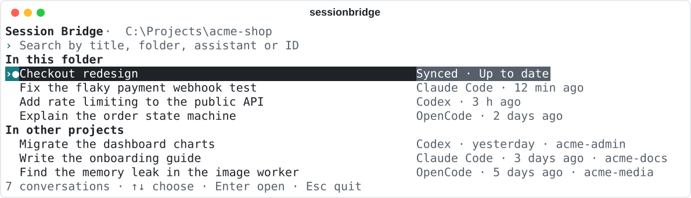
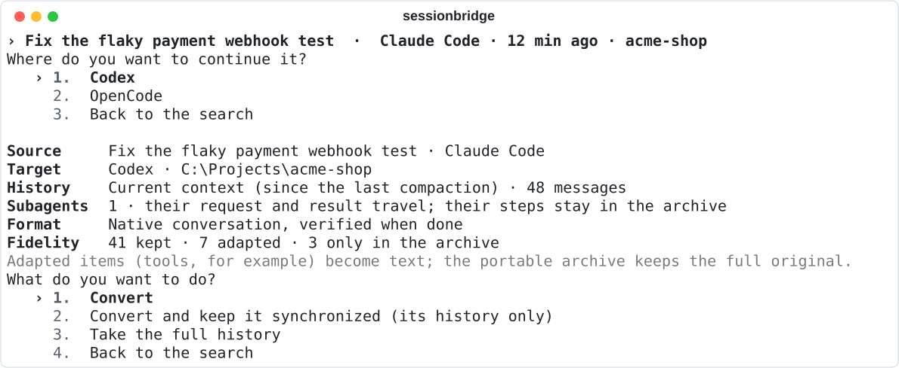

# User guide

This guide covers everything Session Bridge does, task by task. For a short introduction, start with the [README](../README.md); for every option of every command, see the [command reference](cli-reference.md).

**Contents**

- [Before you start](#before-you-start)
- [The start screen](#the-start-screen)
- [Continuing a conversation in another assistant](#continuing-a-conversation-in-another-assistant)
- [Finding conversations from the command line](#finding-conversations-from-the-command-line)
- [Portable archives](#portable-archives)
- [Transfers: checking, recovering and undoing](#transfers-checking-recovering-and-undoing)
- [Profiles](#profiles)
- [Linux and WSL](#linux-and-wsl)
- [Scripting with JSON](#scripting-with-json)
- [Where Session Bridge keeps its data](#where-session-bridge-keeps-its-data)
- [Uninstalling](#uninstalling)
- [Troubleshooting](#troubleshooting)
- [Questions](#questions)

## Before you start

**What you need**

- Windows x64 with [Python 3.11 or newer](https://www.python.org/downloads/).
- At least one of Claude Code, Codex CLI or OpenCode, used at least once so it has conversations on disk.
- For native sessions, a version in the [compatibility table](../README.md#compatibility) or a newer one of the same major version. Other versions can still use [handoff](#native-session-or-handoff).

**Installing**

Download the portable ZIP from the [latest release](https://github.com/pma1999/session-bridge/releases/latest) and extract it to a folder you will keep (for example `C:\Tools\session-bridge`), or clone the repository. Then, from that folder:

```powershell
powershell -NoProfile -ExecutionPolicy Bypass -File scripts/install.ps1 -Python python
```

The installer:

1. checks that Python is 3.11 or newer;
2. creates a private environment in the project's `.venv` folder and installs the exact, pinned dependencies (this first step needs internet access);
3. installs the release's own wheel when there is one (the ZIP), or builds from the sources (a clone);
4. checks the new command runs before it replaces anything;
5. puts `sessionbridge.exe` in `%USERPROFILE%\.local\bin`, and tells you if that folder is not on your `PATH`;
6. writes an installation record to `%LOCALAPPDATA%\SessionBridge\installation.json`, so later installations and updates know the command is theirs to replace;
7. stops the synchronization worker before replacing its code and starts it again afterwards, if it was running.

Keep the project folder where it is: the command runs from it. Running the installer again is safe; it is also how you repair an installation. Close every open `sessionbridge` window first, because Windows locks a running program. Pass `-CommandDirectory <folder>` to put the command somewhere else.

**Checking it works**

```powershell
sessionbridge --version
sessionbridge doctor
```

`doctor` lists the assistants Session Bridge found, their versions and data folders, whether it can write native sessions to them or only prepare a handoff, and any transfer waiting to be recovered. It runs no model and changes nothing.

> [!IMPORTANT]
> Back up any assistant data you cannot replace before your first transfer. Session Bridge never edits an existing session, but the assistants own their storage formats and can change them at any release.

## The start screen

Run `sessionbridge` with no command to open one search over every conversation on your machine.

<picture>
  <source media="(prefers-color-scheme: dark)" srcset="images/home-en-dark.svg">
  
</picture>

- **In this folder** lists conversations whose working folder is the one you started `sessionbridge` from, newest first. **In other projects** lists the rest, with the project's folder name.
- Conversations you keep [synchronized](synchronization.md) come first and are marked **●**.
- Subagent and helper threads are left out: they travel with their parent conversation.
- If an assistant's data cannot be read, a warning line says which, and the others stay usable.

**Searching.** Type part of a title, a folder, an assistant's name or a session ID. Search ignores case and accents, accepts partial words in any order, and keeps the closest matches on top. Typing *synced* finds every synchronized conversation.

**Keys**

| Key | Does |
| --- | --- |
| ↑ ↓, Tab, Shift+Tab | Move through the list |
| Page Up, Page Down | Move a page at a time |
| Enter | Open the selected conversation |
| Esc | Go back one step; on the start screen, leave |
| Ctrl+C | Leave from anywhere |

Every later step is a short numbered menu: choose with the arrow keys and Enter. Esc always goes back without doing anything.

`sessionbridge --all-projects` lists every conversation by date, without the two groups. `--no-color` turns colors off; the `NO_COLOR` environment variable is respected too.

## Continuing a conversation in another assistant

Choose a conversation on the start screen, then the assistant you want to continue in. Session Bridge reads the conversation and shows a summary before it writes anything.

<picture>
  <source media="(prefers-color-scheme: dark)" srcset="images/convert-en-dark.svg">
  
</picture>

| Line | Means |
| --- | --- |
| **Source** | The conversation being copied and its assistant. |
| **Target** | The assistant it will continue in, and the working folder it will open in. |
| **History** | Which part of the conversation is taken (see below) and how many messages that is. |
| **Version** | Shown when you edited an earlier message: which version is taken. |
| **Subagents** | How many subagent requests travel with it. |
| **Format** | A native session, or a manual handoff. |
| **Fidelity** | How many items are kept as they were, adapted to the target's format, or kept only in the archive. |

Then choose what to do:

- **Convert** writes the new session, verifies it, and offers to open it in the target assistant.
- **Convert and keep it synchronized** does the same and links the two, so later turns follow. See [synchronization](synchronization.md).
- **Take the full history** / **Take only the current context** switches what is taken (see below).
- **Choose another version** appears when you edited earlier messages.

Opening the new session starts the target assistant on that exact session, in the right folder, without sending a message or granting any permission. From the command line, the same conversion is:

```powershell
sessionbridge convert claude-win:SESSION_ID --to codex-win --dry-run
sessionbridge convert claude-win:SESSION_ID --to codex-win --resume
```

`--dry-run` shows the summary and writes nothing. `--resume` opens the new session when it is done.

### Current context or full history

Assistants compact long conversations: they replace older turns with a summary. By default Session Bridge takes the **current context**, which is what the source assistant would send its model right now: the last summary and everything after it. **Full history** (`--context all`) takes every turn from the beginning, including what was compacted. The archive always keeps the full original either way.

When Session Bridge cannot tell where the current context begins, it asks you to take the full history or to choose the message to start from (`--context-from MESSAGE_ID`). It never guesses.

### Native session or handoff

A **native session** is written in the target assistant's own format, appears in its history, and resumes like any other. Session Bridge writes native sessions for [verified versions](native-compatibility.md) and for newer ones of the same major version, checking their format on every transfer; the summary says so when that applies.

A **handoff** works with any version. Session Bridge writes the conversation to a context file and gives you a message to paste into a new conversation in the target assistant; the message asks it to read that file as background before doing anything. Choose it on the start screen when native writing is not available, or pass `--mode handoff`. Session Bridge never switches to handoff on its own.

### Edited messages

If you edited an earlier message and sent it again, the conversation exists in more than one version. Session Bridge takes the version the source assistant would resume, and offers the others: the summary shows **Choose another version**, `sessionbridge show` lists them, and `convert` and `import` take `--variant VERSION_ID`. Full history always means the history of the chosen version. [How each assistant records edits](native-compatibility.md#edited-messages-and-subagents) explains the details.

### Subagents

When the conversation delegated work to a subagent, the target receives what the parent's model saw: the request it made and the result it got back. The subagent's own steps stay in the archive.

### What changes on the way

- Text, your messages and the assistant's answers are kept.
- Tool calls and their results become readable text: the target assistant sees what happened, but it cannot replay them.
- Instructions, approvals and permission decisions from the source are kept as history only. The target assistant's own settings and permissions apply.
- Reasoning, provider signatures and anything the target cannot represent stay in the archive.

The **Fidelity** line counts each of these, and `--json` lists them.

## Finding conversations from the command line

```powershell
sessionbridge list
sessionbridge list --all-projects --search "rate limiting"
sessionbridge list --from codex --since 2026-06-01
sessionbridge show codex-win:SESSION_ID
```

`list` shows the current folder's conversations by default. Folders match exactly: a parent folder, a subfolder or a sibling project is a different folder. `--cwd PATH` lists another one and `--all-projects` lists them all.

A session ID has the form `PROFILE:ID`, for example `claude-win:7c1e2f…`. You can type a unique prefix of it, and explicit IDs work from any folder.

## Portable archives

A `.sbridge` file holds a whole conversation: every message, its metadata and its attachments, with checksums for each part.

```powershell
sessionbridge export claude-win:SESSION_ID --output checkout.sbridge
sessionbridge import checkout.sbridge --to codex-win --cwd "C:\Projects\acme-shop"
```

`import` accepts the same choices as `convert`, including `--dry-run`, `--mode handoff` and `--context all`, so you can move a conversation to another computer and continue it there. `--include-file PATH` adds a file of your own to the archive.

Before reading an archive, Session Bridge checks its format version, the exact list of files, every checksum and the size limits, and refuses links, unsafe paths and encrypted entries. A checksum detects a damaged or altered archive; it does not prove who made it. An archive contains private conversation history, so share it as you would the conversation itself.

## Transfers: checking, recovering and undoing

Every conversion and import is a **transfer** with an ID such as `tr_…`, recorded in a local journal with its archive.

```powershell
sessionbridge transfers
sessionbridge resume tr_TRANSFER_ID
sessionbridge recover tr_TRANSFER_ID
sessionbridge undo tr_TRANSFER_ID
```

- `transfers` lists them with their state.
- `resume` opens the session a transfer created. It also accepts a session ID; for a synchronized conversation, it opens that assistant's current session.
- `recover` finishes a transfer that was interrupted, for example by closing the terminal. It checks what was already written and completes it from the verified archive; it never writes the session twice.
- `undo` removes the files of a handoff. For a native session, it checks that the session is still the one Session Bridge wrote, then asks you to delete it from the assistant yourself: no supported assistant offers a deletion Session Bridge can make safe. With `--json`, the error's `details` give the session's `native_id`.

## Profiles

A **profile** is one installation of one assistant, such as `claude-win` or `codex-win`. Session Bridge detects the usual installation folders on its own, and honours `CLAUDE_CONFIG_DIR` and `CODEX_HOME` when they are set.

```powershell
sessionbridge profile list
sessionbridge profile add --id claude-work --tool claude --home "D:\claude-work"
```

Add a profile for a second installation, a data folder in a non-standard place, or a WSL distribution. `profile list` shows each profile's assistant, folder and version, and `doctor` shows what Session Bridge can do with each.

## Linux and WSL

Native sessions are verified on Windows only. On Linux and in WSL, Session Bridge can list, show, export and import conversations, and prepare handoffs; native writing stays disabled until it has been verified there.

**WSL from Windows.** Session Bridge can read conversations of assistants installed inside a WSL distribution through a small helper that runs in that distribution:

```powershell
sessionbridge wsl status
sessionbridge wsl install --distro Ubuntu --wheel dist\session_bridge-X.Y.Z-py3-none-any.whl
```

`wsl status` lists the distributions without starting any. `wsl install` sets up the helper in its own environment inside the chosen distribution, without root. Session Bridge never starts a stopped distribution or installs anything in it unless you ask with `wsl start` or `wsl install`.

**On Linux itself**, `python3 scripts/install.py`, run from the project folder, creates the project's environment and links the command into `~/.local/bin`. This path is not covered by the [verification record](verification.md), and Linux installations do not update themselves.

## Scripting with JSON

Add `--json` to any command for a stable, versioned response:

```json
{"schema_version": 1, "ok": true, "data": {}}
```

```json
{"schema_version": 1, "ok": false, "error": {"code": "source_active", "key": "error.source_active", "message": "…", "details": {}}}
```

- `code` and `key` are stable and the same in every language; `message` is in the language in use and can change.
- With `--json`, commands never ask anything. A command that needs a choice fails with an error saying which option to pass, and `convert --resume` returns the exact command line to open the session instead of opening it.
- Exit codes: `0` success, `2` an error Session Bridge explains (`ok: false`), `1` an unexpected failure, `130` cancelled.

`--json`, `--no-color` and `--lang` work anywhere on the line.

## Where Session Bridge keeps its data

| What | Where |
| --- | --- |
| Transfer journal, archives, handoff files | `%LOCALAPPDATA%\SessionBridge` (`bridge.sqlite3`, `transfers\`) |
| Synchronization store and worker state | `%LOCALAPPDATA%\SessionBridge` (`sync.sqlite3`, `worker.json`) |
| Settings (language, update check) | `%LOCALAPPDATA%\SessionBridge\settings.json` |
| Update state and installer logs | `%LOCALAPPDATA%\SessionBridge\update.json`, `logs\` |
| Installation record, updated versions | `%LOCALAPPDATA%\SessionBridge\installation.json`, `app\`, `runtime\` |
| The command | `%USERPROFILE%\.local\bin\sessionbridge.exe` |

On Linux the data folder is `$XDG_DATA_HOME/session-bridge` (usually `~/.local/share/session-bridge`). Set `SESSIONBRIDGE_HOME` to use a separate data folder, for example to try something out; the installation record and updated versions stay in `%LOCALAPPDATA%\SessionBridge`.

These files contain conversation history. Keep backups of them private.

## Uninstalling

1. Stop the synchronization worker, if you used synchronization: `sessionbridge sync stop`.
2. Delete `%USERPROFILE%\.local\bin\sessionbridge.exe`.
3. Delete the folder you installed from.
4. To remove every transfer, archive and synchronized conversation as well, delete `%LOCALAPPDATA%\SessionBridge`.

Sessions Session Bridge created in your assistants are ordinary sessions of those assistants. Uninstalling leaves them in place.

## Troubleshooting

Each error has a stable code, shown before the message, that you can search for here or in an issue.

| Code or message | Cause | What to do |
| --- | --- | --- |
| `native_unavailable`, *Native conversion is not verified for this target* | The target assistant's version is not in the compatibility table. | Choose the handoff the start screen offers, or pass `--mode handoff`. |
| `native_version_changed` | The installed assistant is older than the verified versions, or a different major version. | Run `sessionbridge doctor`. Update the assistant, or use handoff. |
| `native_format_changed` | A newer Claude Code stores conversations differently from the verified format. | Use handoff, and watch the [releases](https://github.com/pma1999/session-bridge/releases) for a version that supports the new format. |
| `source_active` | The conversation is still open and may be mid-turn. | Finish the turn, or take a snapshot (`--snapshot`, or the start screen's option). |
| `ambiguous_context` | Session Bridge cannot tell where the current context starts. | Take the full history (`--context all`) or pick a starting message (`--context-from`). |
| `cwd_missing`, `cwd_required` | The working folder does not exist on this machine, or is unknown. | Pass `--cwd` with the folder to open the session in. The start screen asks for it. |
| `native_limit`, `source_too_large` | The conversation is larger than the target accepts. | Take the current context instead of the full history, or use handoff. Nothing is ever truncated. |
| `recovery_required`, `native_operation_failed` | An earlier transfer did not finish. | Run `sessionbridge transfers`, then `sessionbridge recover tr_…`. |
| `operation_busy` | Another Session Bridge command is writing. | Wait for it to finish. |
| `undo_manual_required` | Session Bridge does not delete native sessions itself. | Delete the session from the assistant. `sessionbridge --json undo tr_…` shows its `native_id`. |
| *Refusing to replace an unmanaged command.* (installer) | A `sessionbridge.exe` the installer did not create is in the way. | Check that it is yours, delete it, and run the installer again. |
| Installer fails to replace the command | A `sessionbridge` window is still open. | Close every `sessionbridge` window and run the installer again. |
| `update_failed` | The new version's installer failed. | The version you have still works. Read the log the message names, then run `sessionbridge update`. See [updates](updates.md). |
| `update_unavailable` | GitHub could not be reached. | Check the connection; Session Bridge tries again later on its own. |

For synchronization errors, see the [synchronization guide](synchronization.md#when-something-goes-wrong). If something is not covered here, [open an issue](https://github.com/pma1999/session-bridge/issues) with the code, the command, `sessionbridge --version` and `sessionbridge doctor` output. Leave out conversation content and personal paths.

## Questions

**Does Session Bridge send my conversations anywhere?**
No. It has no server and calls no model. The only request it makes on its own is the update check to GitHub, which sends no conversation data and can be turned off.

**Will it change my original conversation?**
No. Sources are only read. A transfer creates a new session in the target and keeps an archive of what it read.

**Can I continue in the target assistant and later come back?**
Yes. Either convert again, or [link the conversation](synchronization.md) and switch with `sessionbridge sync open` as often as you like.

**Why does a converted session open as a new session instead of updating an open tab?**
None of the supported assistants lets another program add turns to a session safely while it may be open, and open tabs do not reload from disk. Session Bridge therefore always writes a new session, and leaves existing ones untouched.

**My assistant just updated and native conversion stopped working.**
A newer version of the same major version keeps working: Session Bridge checks its format on every transfer. It stops only when that check fails, because the assistant changed how it stores conversations, or when the major version changes. Use handoff in the meantime, and watch the [releases](https://github.com/pma1999/session-bridge/releases) for a version that supports it.

**Does it copy my files, Git state or permissions?**
No. It moves conversations only. The target assistant works on the folder you choose, with its own permissions.
